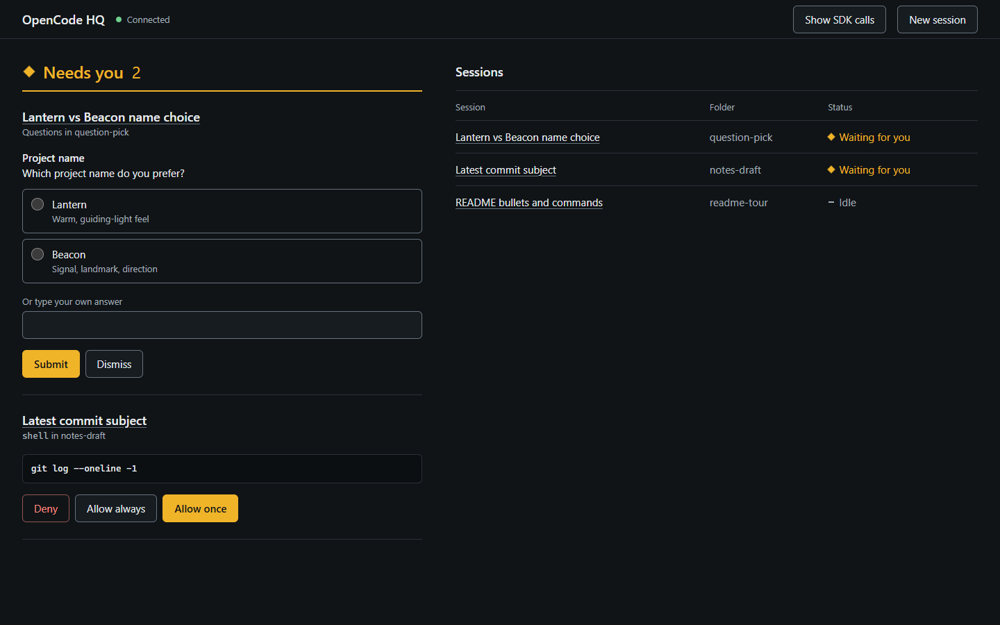

# opencode SDK for .NET

[](https://www.nuget.org/packages/OpenCodeDotNet.Sdk) [](https://github.com/opencode-dotnet/opencode-sdk-dotnet/actions/workflows/ci.yml) [](https://api.localstackfor.net/redirect/test-results/windows/opencode-dotnet/opencode-sdk-dotnet/master) [](https://github.com/opencode-dotnet/opencode-sdk-dotnet/blob/master/LICENSE)

> **Unofficial.** This project is not affiliated with or endorsed by the [opencode](https://opencode.ai) team.

A typed .NET client for the [opencode](https://github.com/anomalyco/opencode) server: the HTTP API
that every opencode front-end (TUI, desktop, web UI, plugins) uses. From C#, you start a server or
connect to one, send a prompt to a session, read the reply as the model writes it, answer the
agent's permission requests, and see what a turn changed. The SDK speaks the OpenCode 2.x API.

## 📦 Installation

```bash
dotnet add package OpenCodeDotNet.Sdk
dotnet add package OpenCodeDotNet.Sdk.Extensions   # dependency injection, optional
npm install -g @opencode/cli@2.4.1                 # the opencode CLI, for the quick start
```

- **The package id is not the namespace.** You install `OpenCodeDotNet.Sdk` and you write
  `using OpenCode.Sdk;`. nuget.org reserves the `OpenCode.` id prefix for an unrelated owner.
- **The CLI is the `@opencode/cli` npm package.** The version on the line above is this SDK's
  *pin*: the opencode release it is built and tested against. Later releases usually work, but the
  tests do not run against them. If you already run a server, you need no CLI: [connect to its endpoint](https://github.com/opencode-dotnet/opencode-sdk-dotnet/blob/master/docs/guide/connection-modes.md#-a-server-you-already-run).
- **Nightly builds** of `master` are on GitHub Packages: see [Nightly builds](https://github.com/opencode-dotnet/opencode-sdk-dotnet/blob/master/docs/guide/getting-started.md#nightly-builds-github-packages).

## 🚀 Quick Start

```csharp
using OpenCode.Sdk;
using OpenCode.Sdk.Models;

await using var server = await OpenCodeServer.StartAsync();
using var client = server.CreateClient();

var created = await client.Sessions.CreateSessionAsync(new SessionCreateRequest { Title = "hello from .NET" });
Console.WriteLine($"session {created.Session.Id}");
```

`OpenCodeServer.StartAsync()` starts a private `opencode serve` process, and disposing the server
stops it. For complete programs, see the [four runnable apps](#-what-you-can-build).

### Send a prompt and stream the reply

This program picks a model of opencode's own provider with zero listed input and output rates,
opens the live event stream before it prompts, and prints the reply as it arrives. The token
requests cancellation after two minutes; a call that is still pending then throws
`OperationCanceledException`.

```csharp
using OpenCode.Sdk;
using OpenCode.Sdk.Models;

using var deadline = new CancellationTokenSource(TimeSpan.FromMinutes(2));
var token = deadline.Token;

await using var server = await OpenCodeServer.StartAsync(cancellationToken: token);
using var client = server.CreateClient();

// To use your own provider, replace this block with: var model = new ModelRef { Id = "...", ProviderId = "..." };
await client.LanguageModels.WaitForDefaultAsync(cancellationToken: token);
var catalog = await client.LanguageModels.ListModelsAsync(cancellationToken: token);
var model = catalog.Models.FirstOrDefault(static m =>
    m.ProviderId == "opencode" && m.Cost.Count > 0 && m.Cost.All(static c => c.Input <= 0 && c.Output <= 0));
if (model is null)
{
    await Console.Error.WriteLineAsync("No opencode model lists zero input and output rates yet. The server may still be loading plugins: run the program again.");
    return;
}

var created = await client.Sessions.CreateSessionAsync(
    new SessionCreateRequest { Model = new ModelRef { Id = model.Id, ProviderId = model.ProviderId } },
    cancellationToken: token);

// Subscribe before you prompt: the live event stream has no replay.
await using var events = client.Events.SubscribeAsync(cancellationToken: token).GetAsyncEnumerator();
await events.MoveNextAsync();

await client.Sessions.GetSessionClient(created.Session.Id)
    .PromptAsync(new SessionPromptRequest { Text = "In one sentence, what is a typed SDK?" }, cancellationToken: token);

while (await events.MoveNextAsync())
{
    switch (events.Current)
    {
        case SessionTextDelta delta when delta.Data.SessionId == created.Session.Id:
            Console.Write(delta.Data.Delta);
            break;
        case SessionExecutionSucceeded done when done.Data.SessionId == created.Session.Id:
            Console.WriteLine();
            return;
        case SessionExecutionFailed failed when failed.Data.SessionId == created.Session.Id:
            Console.WriteLine($"the turn failed: {failed.Data.Error.Message}");
            return;
        case SessionExecutionInterrupted stopped when stopped.Data.SessionId == created.Session.Id:
            Console.WriteLine($"the turn was interrupted: {stopped.Data.Reason}");
            return;
    }
}
```

- **The model.** Free `opencode/*` models need no login; their list changes, and they have limits.
  [Choosing a model](https://github.com/opencode-dotnet/opencode-sdk-dotnet/blob/master/docs/guide/getting-started.md#choosing-a-model) shows how to use your own provider.
- **The folder.** The session runs in the folder you start the program from. The agent can read
  that folder's files, and what it sends, your prompt included, goes to the model's provider.
- **The full version.** [QuickStart](https://github.com/opencode-dotnet/opencode-sdk-dotnet/tree/master/playground/quickstart) also waits out the server's startup
  and reports retries. The program above answers no permission asks;
  [Streaming](https://github.com/opencode-dotnet/opencode-sdk-dotnet/blob/master/docs/guide/streaming.md#-answering-permissions-and-questions) shows the replies, and how to
  [wait for a turn to end](https://github.com/opencode-dotnet/opencode-sdk-dotnet/blob/master/docs/guide/streaming.md#-waiting-for-a-turn-to-end) when a server's events
  differ from the SDK's.

### Choose a connection mode

| You want… | Use | Who stops the server |
|---|---|---|
| A private server for this app only | `OpenCodeServer.StartAsync()` | The SDK, when you dispose it |
| A server you already run | `new OpenCodeClient(options)` | You |
| The background service the CLI shares with other clients | `OpenCodeServer.DiscoverAsync()` or `EnsureAsync()` | Nobody, unless you call `StopAsync()` |
| The server the opencode CLI itself would choose | `OpenCodeServer.ResolveAsync()` | Disposal stops only an owned standalone server |

[Connection modes](https://github.com/opencode-dotnet/opencode-sdk-dotnet/blob/master/docs/guide/connection-modes.md) has each mode with its options. For dependency injection,
the `OpenCodeDotNet.Sdk.Extensions` package provides `AddOpenCode`, which registers the client and
every sub-client: see [Registering with dependency injection](https://github.com/opencode-dotnet/opencode-sdk-dotnet/blob/master/docs/guide/connection-modes.md#-registering-with-dependency-injection).

## 🧰 What you can build

Four runnable apps are in [`playground/`](https://github.com/opencode-dotnet/opencode-sdk-dotnet/tree/master/playground). Each app's README has its run command.

| App | What it shows |
|---|---|
| [QuickStart](https://github.com/opencode-dotnet/opencode-sdk-dotnet/tree/master/playground/quickstart), a console app | A prompt whose reply prints as it arrives. It returns exit code 0 or 1, so you can adapt it to a step of a CI job; it is not a ready-made CI integration. |
| [HQ](https://github.com/opencode-dotnet/opencode-sdk-dotnet/tree/master/playground/hq), Blazor Server with Aspire | A local dashboard: watch sessions, answer permission asks and the supported question types, and see a session's changed files. It has no login, so run it on your own machine only. |
| [Worker](https://github.com/opencode-dotnet/opencode-sdk-dotnet/tree/master/playground/worker), a Generic Host console app | A hosted service that reads the live event stream, and exits with code 1 when its server ends so that a service manager restarts it. |
| [AotCli](https://github.com/opencode-dotnet/opencode-sdk-dotnet/tree/master/playground/aotcli), a Native AOT console app | A native executable that inspects a repository. It needs no model. |



QuickStart and Worker work in the folder you start them from. HQ works in the directory you pick
for each session, and it shows the machine's existing opencode history. AotCli takes a path. The
server loads that folder's configuration, and a session's prompts go to the model's provider.

## 🧭 API Coverage

The SDK covers the whole opencode HTTP API at the pinned version, and three of its WebSocket
connections: terminals, persistent terminals and client-hosted MCP. A door for the fourth, the
experimental machine link, is planned. `OpenCodeClient` exposes one
sub-client per area of the API, and each sub-client is also injectable on its own.
[How the client is organised](https://github.com/opencode-dotnet/opencode-sdk-dotnet/blob/master/docs/guide/getting-started.md#-how-the-client-is-organised) lists each area
with its entry point and guide.

- HTTP operations return typed responses, and take typed requests where the operation has inputs.
  That includes opencode's unions without a discriminator, which off-the-shelf .NET OpenAPI
  generators did not represent correctly.
- A call throws a typed exception by default. On calls that accept
  `OpenCodeRequestOptions.NoThrow`, a declared API error such as a 404 comes back in the response.
  Transport failures still throw.
- The same transport pipeline serves every connection mode.
- JSON uses `System.Text.Json` source generation, with no reflection. Both packages declare
  `IsAotCompatible` on `net10.0` and `net11.0`.
- The HTTP API has no file-content search: `FileSystemClient.FindEntriesAsync` ranks file and
  directory paths by fuzzy match; it does not search contents.

## 📚 Documentation

| Guide | What it covers |
|---|---|
| [**The guide**](https://github.com/opencode-dotnet/opencode-sdk-dotnet/blob/master/docs/guide/README.md) | Index of every page below, in reading order |
| [Getting started](https://github.com/opencode-dotnet/opencode-sdk-dotnet/blob/master/docs/guide/getting-started.md) | Install, nightly builds, first call, and how the client is organised |
| [Connection modes](https://github.com/opencode-dotnet/opencode-sdk-dotnet/blob/master/docs/guide/connection-modes.md) | The launcher, a server you already run, the background service, pairing, and dependency injection |
| [Streaming](https://github.com/opencode-dotnet/opencode-sdk-dotnet/blob/master/docs/guide/streaming.md) | The live event stream and durable session event streams |
| [Terminals](https://github.com/opencode-dotnet/opencode-sdk-dotnet/blob/master/docs/guide/terminals.md) | PTY and persistent-PTY sessions over WebSocket |
| [Errors and responses](https://github.com/opencode-dotnet/opencode-sdk-dotnet/blob/master/docs/guide/errors-and-responses.md) | Throwing versus `NoThrow`, and the typed error model |
| [Pagination](https://github.com/opencode-dotnet/opencode-sdk-dotnet/blob/master/docs/guide/pagination.md) | Cursor-carrying list envelopes, `Enumerate*Async`, and its `Pages` |
| [Requests](https://github.com/opencode-dotnet/opencode-sdk-dotnet/blob/master/docs/guide/requests.md) | Request records, members that are omitted, null or set, query members, and per-call location |
| [Experimental APIs](https://github.com/opencode-dotnet/opencode-sdk-dotnet/blob/master/docs/guide/experimental.md) | What opencode serves as experimental, the `OPENCODE001` and `OPENCODE002` diagnostics, and how to opt in |
| [Versioning and support](https://github.com/opencode-dotnet/opencode-sdk-dotnet/blob/master/docs/guide/versioning-and-support.md) | Supported .NET versions, what a version number promises, and costs on older runtimes |

## 📌 Versions and support

- **.NET versions.** Both packages target `netstandard2.0;net472;net10.0;net11.0`: every .NET
  release that is still in support under [Microsoft's .NET support policy](https://dotnet.microsoft.com/platform/support/policy),
  plus .NET Framework 4.7.2 or later, plus `netstandard2.0` as a compatibility asset.
- **.NET 8.** NuGet selects the `netstandard2.0` asset, with a build warning. It installs and
  builds; it is not tested or supported on that runtime. It brings extra dependencies and misses
  the optimizations specific to the modern targets.
- **Version numbers.** A version follows the bump type of the opencode release it pins: an upstream
  patch is an SDK patch, a minor a minor, a major a major. This is not strict SemVer. A release
  that moves the pin, a patch included, can change the generated protocol types the way opencode
  changed them, and the [CHANGELOG](https://github.com/opencode-dotnet/opencode-sdk-dotnet/blob/master/CHANGELOG.md) lists each such change as **breaking** under
  Protocol changes. The hand-written API breaks only in a major.
- **Experimental APIs** need an opt-in (`OPENCODE001`, `OPENCODE002`) and may change in any release
  that moves the pin.
- **Releases.** Each GitHub Release publishes that version's CHANGELOG section. Only the latest
  release on NuGet.org is supported.

The details are in [Versioning and support](https://github.com/opencode-dotnet/opencode-sdk-dotnet/blob/master/docs/guide/versioning-and-support.md): the rule behind the targets, why .NET Framework keeps its own asset, and what can break when.

## ✅ Build, test and package status

| Tests | Status | Targets |
|---|---|---|
| Linux | [](https://api.localstackfor.net/redirect/test-results/linux/opencode-dotnet/opencode-sdk-dotnet/master) | `net10.0`, `net11.0` |
| Windows | [](https://api.localstackfor.net/redirect/test-results/windows/opencode-dotnet/opencode-sdk-dotnet/master) | `net472`, `net10.0`, `net11.0` |
| macOS | [](https://api.localstackfor.net/redirect/test-results/macos/opencode-dotnet/opencode-sdk-dotnet/master) | `net10.0`, `net11.0` |
| Published CLI | [](https://github.com/opencode-dotnet/opencode-sdk-dotnet/actions/workflows/consumer-leg.yml) | Weekly: the core `net10.0` tests and three playground apps (AotCli, Worker and HQ) against the published `@opencode/cli` release |

| Package | NuGet.org | GitHub Packages |
|---------|-----------|-----------------|
| **OpenCodeDotNet.Sdk** | [](https://www.nuget.org/packages/OpenCodeDotNet.Sdk) | [](https://github.com/opencode-dotnet/opencode-sdk-dotnet/pkgs/nuget/OpenCodeDotNet.Sdk) |
| **OpenCodeDotNet.Sdk.Extensions** | [](https://www.nuget.org/packages/OpenCodeDotNet.Sdk.Extensions) | [](https://github.com/opencode-dotnet/opencode-sdk-dotnet/pkgs/nuget/OpenCodeDotNet.Sdk.Extensions) |

## Known Issues

- **The live event stream has no replay.** Events published while you are disconnected are lost. A
  subscription queues up to 4,096 selected events; the next one that cannot be queued ends it with
  `OpenCodeEventSubscriberOverflowException`: see
  [recovering after subscriber overflow](https://github.com/opencode-dotnet/opencode-sdk-dotnet/blob/master/docs/guide/streaming.md#-recovering-after-subscriber-overflow).
- **A CLI-started server's durable session event stream holds only the sync marker**, because the
  distributed CLI starts its server without event persistence: see
  [a single session's log](https://github.com/opencode-dotnet/opencode-sdk-dotnet/blob/master/docs/guide/streaming.md#-a-single-sessions-log).
- **On `net472` and `netstandard2.0`, some memory costs are larger than on modern targets:** see
  [costs on the older assets](https://github.com/opencode-dotnet/opencode-sdk-dotnet/blob/master/docs/guide/versioning-and-support.md#costs-on-the-older-assets).
- **A terminal queues frames that nobody reads**, so a slow or absent reader can grow memory: see
  the [terminal lifetime contract](https://github.com/opencode-dotnet/opencode-sdk-dotnet/blob/master/docs/guide/terminals.md).

## 🤝 Contributing and support

- **Contribute:** [CONTRIBUTING.md](https://github.com/opencode-dotnet/opencode-sdk-dotnet/blob/master/CONTRIBUTING.md) shows the path of a small pull request and
  the checks it runs.
- **Ask a question:** read [the guide](https://github.com/opencode-dotnet/opencode-sdk-dotnet/blob/master/docs/guide/README.md) first; if it does not answer, ask in the [Q&A category of Discussions](https://github.com/opencode-dotnet/opencode-sdk-dotnet/discussions/categories/q-a).
- **Report a bug or propose a feature:** [SUPPORT.md](https://github.com/opencode-dotnet/opencode-sdk-dotnet/blob/master/.github/SUPPORT.md) says which form to
  use and what is supported.
- **Report a vulnerability:** privately, as [SECURITY.md](https://github.com/opencode-dotnet/opencode-sdk-dotnet/blob/master/.github/SECURITY.md) says. Never in a
  public issue.

## Related Projects

- [opencode-mcp](https://github.com/opencode-dotnet/opencode-mcp): a Model Context Protocol (MCP) server project for opencode.
- [opencode-agents-ai](https://github.com/opencode-dotnet/opencode-agents-ai): a Microsoft Agent Framework provider project for opencode.

## License

Licensed under MIT, see [LICENSE](https://github.com/opencode-dotnet/opencode-sdk-dotnet/blob/master/LICENSE) for the full text. Content derived from
upstream opencode carries its own notice in
[THIRD-PARTY-NOTICES.md](https://github.com/opencode-dotnet/opencode-sdk-dotnet/blob/master/THIRD-PARTY-NOTICES.md).
